  

<table>
  <tr>
    <td valign="centre"></td>
    <td valign="top"></td>
  </tr>
</table>

<!-- HERO SECTION -->

  <h1>Hi 👋, I'm <a href="https://github.com/Sharma964">Sonu Sharma</a></h1>
  <h3><strong>Computer Engineering Student • AI/ML Enthusiast • Full-Stack Developer</strong></h3>
  
<i>Building intelligent AI systems, robust full-stack web applications, and algorithmic solutions to solve real-world problems.</i>

  

    
    
    
    
    
    
  

 

<!-- ================= ABOUT ME ================= -->
## 🚀 About Me

- 🎓 **Computer Engineering student** passionate about building practical, impact-driven technology solutions.
- 🤖 Deeply interested in **Artificial Intelligence, Machine Learning, and Data Science**.
- 💻 Building modern, responsive web applications with **React, Next.js, Node.js, and TypeScript**.
- 🧠 Continuously mastering **Data Structures &amp; Algorithms (DSA)** and competitive problem-solving.
- 🔬 Currently developing an **AI-Based Landslide Prediction &amp; Early Warning System** for disaster risk reduction in Nepal.
- 🌍 Exploring scalable backend systems, system design, cloud infrastructure, and Web3 / Blockchain.
- 🤝 Open to collaborating on innovative **AI/ML, Full-Stack Development, and Open Source projects**.

---

<!-- ================= FLAGSHIP PROJECT SPOTLIGHT ================= -->
## 🔭 Flagship Project Spotlight

### 🌋 [AI-Based Landslide Prediction &amp; Early Warning System](https://github.com/Sharma964/AI-LandSlide-Early-Predication)

An end-to-end AI-driven system engineered to evaluate landslide vulnerability and deliver real-time early warnings by integrating Machine Learning algorithms, environmental rainfall analytics, and GIS location datasets tailored for Nepal's terrain.

- 🤖 **Machine Learning Predictive Modeling**: High-precision risk classification based on geological &amp; meteorological data.
- 🌧️ **Environmental Factors**: Live precipitation thresholds, soil saturation, and slope gradient parameters.
- 🗺️ **GIS Risk Mapping**: Interactive geospatial visualization and danger zone mapping.
- 🚨 **Automated Alerts**: Rapid early warning triggers for communities and disaster response teams.
- 📊 **Tech Stack**: `Python` • `TypeScript` • `Machine Learning` • `GIS` • `Data Analytics`

  

---

<!-- ================= FEATURED PROJECTS ================= -->
## 🚀 Featured &amp; Recent Projects

<table>
  <tr>
    <td width="50%" valign="top">
      <h3 align="center">🌐 <a href="https://github.com/Sharma964/Personal-Portfolio">Personal Portfolio Website</a></h3>
      
Modern personal portfolio showcasing projects, technical competencies, and developer journey with responsive layouts and interactive UI.

      
<code>TypeScript</code> • <code>React</code> • <code>Tailwind CSS</code> • <code>Vite</code>

    </td>
    <td width="50%" valign="top">
      <h3 align="center">🌋 <a href="https://github.com/Sharma964/AI-LandSlide-Early-Predication">AI Landslide Early Prediction</a></h3>
      
AI-powered landslide prediction and early warning platform combining ML, environmental indicators, and GIS mapping for disaster risk reduction in Nepal.

      
<code>Python</code> • <code>TypeScript</code> • <code>ML</code> • <code>GIS</code>

    </td>
  </tr>
  <tr>
    <td width="50%" valign="top">
      <h3 align="center">🔥 <a href="https://github.com/Sharma964/Smart-Fire-Emergency-Response">Smart Fire Emergency Response</a></h3>
      
AI-driven smart fire emergency response system designed for rapid hazard detection, instant alert dissemination, and emergency logistics coordination.

      
<code>JavaScript</code> • <code>AI / ML</code> • <code>IoT</code> • <code>APIs</code>

    </td>
    <td width="50%" valign="top">
      <h3 align="center">📊 <a href="https://github.com/Sharma964/DSA-Visualizer">Interactive DSA Visualizer</a></h3>
      
Dynamic web-based algorithm visualizer bringing sorting, graph traversals, trees, and core data structures to life with step-by-step animations.

      
<code>TypeScript</code> • <code>Algorithms</code> • <code>Data Structures</code> • <code>Canvas</code>

    </td>
  </tr>
  <tr>
    <td width="50%" valign="top">
      <h3 align="center">🍔 <a href="https://github.com/Sharma964/FoodExpress-3d">FoodExpress 3D Web Experience</a></h3>
      
Interactive 3D online food discovery and ordering web application built with modern web graphics and responsive design.

      
<code>TypeScript</code> • <code>Three.js</code> • <code>React</code> • <code>Web3D</code>

    </td>
    <td width="50%" valign="top">
      <h3 align="center">🩺 <a href="https://github.com/Sharma964/Health-AI-Chatbot">Health AI Conversational Assistant</a></h3>
      
Intelligent healthcare conversational assistant providing symptom guidance, medical information triage, and intuitive health insights.

      
<code>JavaScript</code> • <code>AI / NLP</code> • <code>Node.js</code> • <code>APIs</code>

    </td>
  </tr>
</table>

  

---

<!-- ================= TECHNICAL SKILLS ================= -->
## 🛠️ Technical Competencies

### 💻 Programming Languages

  &nbsp;&nbsp;
  &nbsp;&nbsp;
  &nbsp;&nbsp;
  &nbsp;&nbsp;
  

### 🌐 Frontend Development

  &nbsp;&nbsp;
  &nbsp;&nbsp;
  &nbsp;&nbsp;
  &nbsp;&nbsp;
  

### ⚙️ Backend, APIs &amp; Databases

  &nbsp;&nbsp;
  &nbsp;&nbsp;
  &nbsp;&nbsp;
  &nbsp;&nbsp;
  

### 🤖 AI, Machine Learning &amp; Data Science

  &nbsp;&nbsp;
  &nbsp;&nbsp;
  &nbsp;&nbsp;
  

### 🛠️ Developer Tools &amp; Environments

  &nbsp;&nbsp;
  &nbsp;&nbsp;
  &nbsp;&nbsp;
  

---

<!-- ================= GITHUB STATS & STREAK ================= -->
## 📈 GitHub Streak &amp; Activity

  

  

---

<!-- ================= CURRENT FOCUS & 2026 GOALS ================= -->
## 🎯 Current Focus &amp; 2026 Goals

- 🚀 **Deploy Real-World AI Systems**: Expand AI Landslide Prediction and Smart Fire Response into field-tested solutions.
- 🧠 **Master Advanced DSA**: Deepen algorithmic intuition, graph theory, dynamic programming, and complexity optimization.
- 🌐 **Scalable Architecture**: Engineer scalable full-stack applications with microservices and caching.
- 🤝 **Open-Source Contributions**: Contribute meaningfully to major developer tooling and AI/ML ecosystems.
- 📚 **System Design &amp; Cloud**: Gain practical mastery of distributed systems, cloud computing, and CI/CD pipelines.

---

<!-- ================= CONNECT WITH ME ================= -->
## 🤝 Connect With Me

  

    
    
    
    
  

  

    <i>📍 Nepal &nbsp;•&nbsp; ✉️ <a href="mailto:sonusharma.dev07@gmail.com">sonusharma.dev07@gmail.com</a> &nbsp;•&nbsp; 🌐 <a href="https://sonusharma7.com.np">sonusharma7.com.np</a></i>
  

  
  

    <i>✨ Building • Learning • Experimenting • Growing 🚀</i>
  

